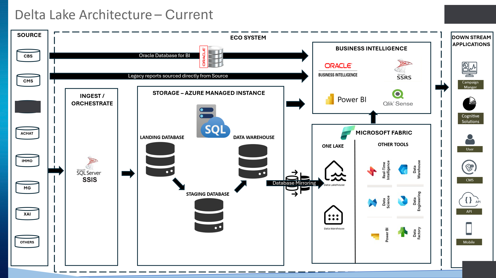
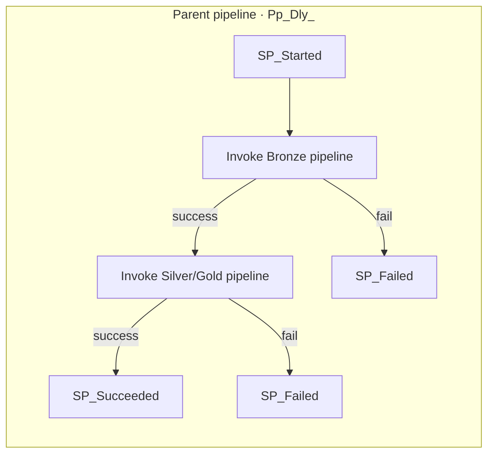
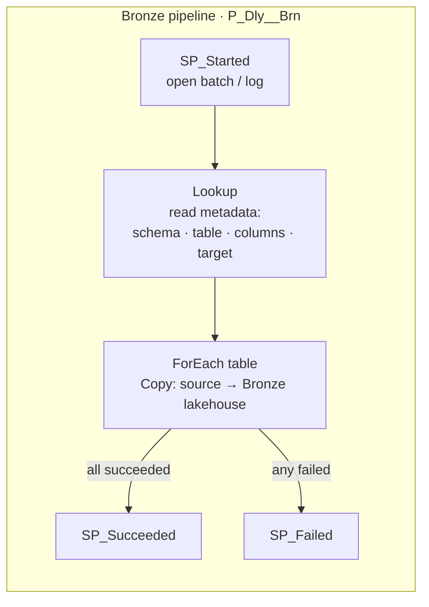
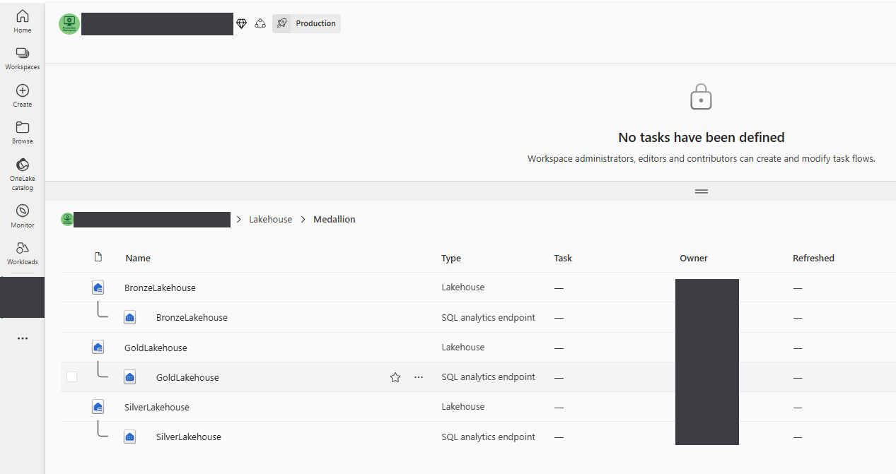
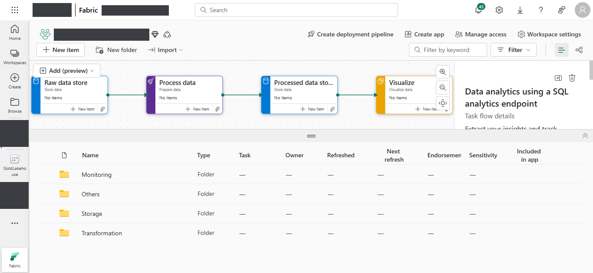
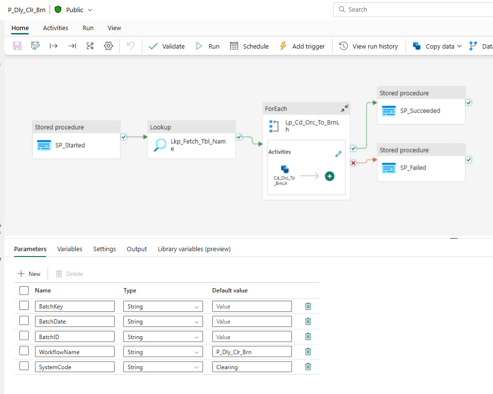
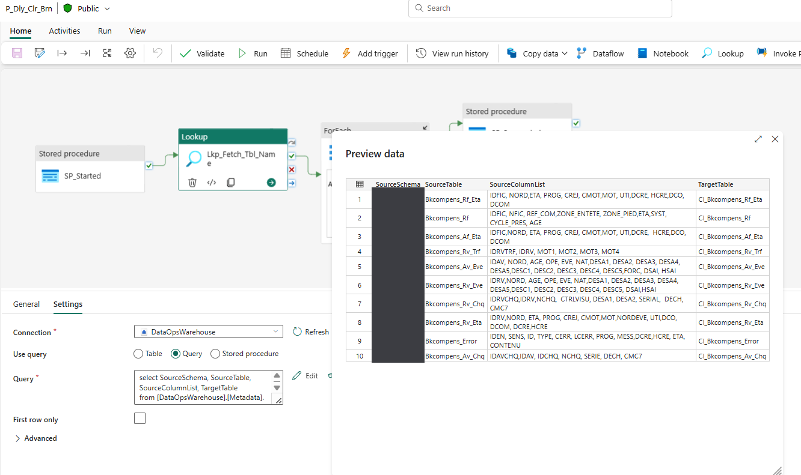
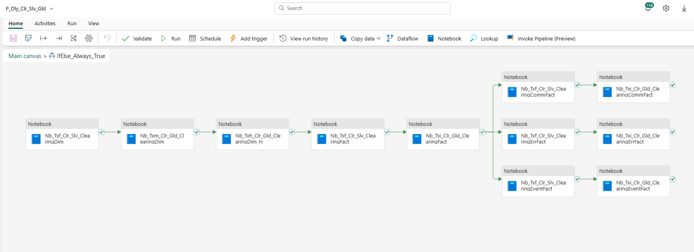
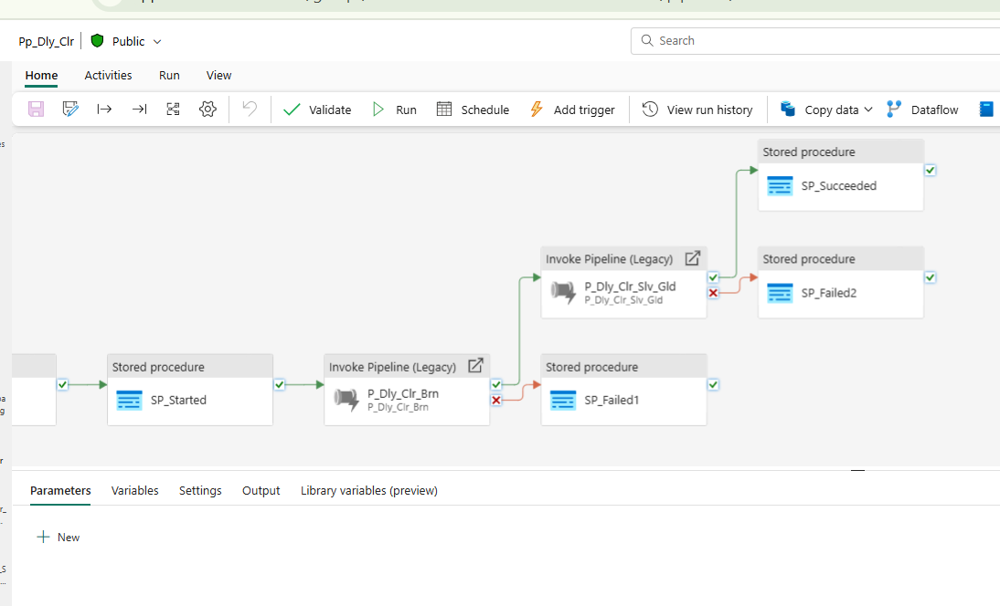
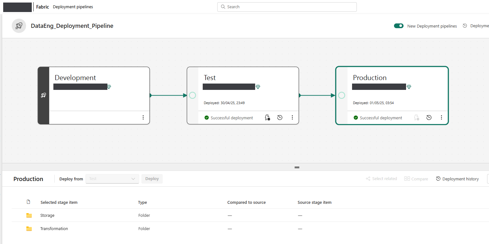

# Metadata-Driven Pipeline Framework for Microsoft Fabric

> A reusable ingestion and transformation framework in which **metadata tables and stored procedures**, not hard-coded pipelines, decide what gets loaded. One standard pipeline pattern serves every source system (core banking, card management and others), with control tables, batch tracking, activity logs and error logs built in.

`Microsoft Fabric` · `Data Factory pipelines` · `Fabric Warehouse` · `Lakehouse (Bronze/Silver/Gold)` · `Stored procedures (T-SQL)` · `PySpark notebooks` · `Spark connector for Fabric DW` · `Fabric deployment pipelines`

---

## Overview

A bank's data platform takes data from many source systems, each with dozens or hundreds of tables. Building one pipeline per table doesn't scale, and every new table means new code to write, test and deploy.

This framework flips that around: **pipelines are generic, and metadata defines the work.** Adding a table means adding a metadata row. Every run is wrapped in batch tracking and logging, so operations can see exactly what ran, what succeeded and what failed.

## Problem and goals

**Problem**
- Table-by-table pipelines duplicate logic and are expensive to maintain.
- Inconsistent logging made failures hard to diagnose.
- Onboarding a new source system took significant development effort.

**Goals**
- One common pipeline structure across source systems.
- Metadata-driven table selection, column projection and target mapping.
- Standard batch, activity and error logging through stored procedures.
- Onboarding a new table should be a configuration change, not a code change.

## Platform context

The framework runs on the bank's Fabric platform. Source systems feed a medallion lakehouse layout (Bronze → Silver → Gold), and a **DataOps Warehouse** holds the framework's metadata and control schemas.

*Current-state platform: source systems, legacy SSIS / SQL Managed Instance path, database mirroring into OneLake, and Fabric serving BI and downstream applications.*

## How it works

1. **Parent orchestration.** A daily parent pipeline per source system opens the run (`SP_Started`), invokes the Bronze pipeline and then the Silver/Gold pipeline. It closes with `SP_Succeeded` or `SP_Failed`, so every outcome is logged.
2. **Bronze ingestion.** A **Lookup** reads the metadata table (`SourceSchema`, `SourceTable`, `SourceColumnList`, `TargetTable`). A **ForEach** runs a parameterised **Copy** activity for each table, from source to Bronze lakehouse.
3. **Pipeline parameters.** `BatchKey`, `BatchDate`, `BatchID`, `WorkflowName` and `SystemCode` (for example `Clearing`) flow through every activity and log record.
4. **Silver and Gold transformation.** A notebook chain builds dimensions, then Gold dimensions (including history), then facts, and finally several fact notebooks in parallel (for example commission, error and event facts).
5. **Logging.** Stored procedures write to control and log tables at the start, success and failure of each run.
6. **Promotion.** Fabric deployment pipelines move the framework through Development → Test → Production.

## Metadata and control model

| Schema | Object | Purpose |
|---|---|---|
| `Metadata` | `Src_Brn_Tbl_Lst` | Source-to-Bronze table list: source system, schema, table, column list, target table |
| `Metadata` | `Control_Notebook_Exec_vw` | Silver notebook execution plan: notebook, sequence number, parallel group, status |
| `CFR` | `BatchInfo` | Batch definitions (ID, date) |
| `CFR` | `BatchProcessingLog`, `MasterExecutionLog` | Run-level execution history |
| `CFR` | `TableActivityLogs` | Per-table load status (used by the [rerun framework](https://github.com/Bilal1850/fabric-pipeline-rerun-framework)) |
| `CFR` | `NoteBookActivityLog` | Per-notebook status per batch |
| `CFR` | `pipeline_control`, `pipeline_log` | Pipeline control and logging |

## Naming conventions

| Prefix / token | Meaning | Example |
|---|---|---|
| `Pp_` | Parent pipeline | `Pp_Dly_Clr` |
| `P_` | Child pipeline | `P_Dly_Clr_Brn` |
| `Dly` | Daily schedule | |
| `Brn` / `Slv` / `Gld` | Medallion layer | `P_Dly_Clr_Slv_Gld` |
| `Cd_Orc_To_BrnLh` | Copy data: Oracle source → Bronze lakehouse | |
| `Lkp_` | Lookup activity | `Lkp_Fetch_Tbl_Name` |
| `Nb_Txf_` / `Nb_Txm_` / `Nb_Txh_` / `Nb_Txi_` | Transformation notebooks by type | `Nb_Txf_Clr_Slv_ClearingDim` |

## Adding a new table or source

- **New table in an existing source:** insert a row into `Metadata.Src_Brn_Tbl_Lst` (schema, table, columns, target). The next run picks it up, with no pipeline change.
- **New source system:** clone the standard parent/Bronze/Silver-Gold pattern with a new `SystemCode`, register its tables in metadata, and add its Silver notebooks to the notebook control table.

## Code samples

| File | Description |
|---|---|
| [`samples/metadata_lookup.sql`](samples/metadata_lookup.sql) | Metadata lookup that drives the ForEach copy |
| [`samples/warehouse_connector_example.py`](samples/warehouse_connector_example.py) | Reading and writing Fabric Warehouse tables from Spark with the `synapsesql` connector ([docs](https://learn.microsoft.com/fabric/data-engineering/spark-data-warehouse-connector)) |

## Business value

- **Faster onboarding:** a new table is one metadata row, not a new pipeline.
- **Lower maintenance:** a single tested pattern replaces many bespoke pipelines.
- **Operational transparency:** standard batch, activity and error logs across all sources.
- **Foundation for automation:** the same control tables drive the automated [Pipeline Rerun Framework](https://github.com/Bilal1850/fabric-pipeline-rerun-framework).

## Screenshots

| Medallion lakehouses | Workspace structure |
|---|---|
|  |  |
| Bronze, Silver and Gold lakehouses in production | Workspace organized into Monitoring, Storage and Transformation |

| Bronze pipeline and parameters | Metadata lookup preview |
|---|---|
|  |  |
| SP_Started → Lookup → ForEach copy → SP_Succeeded / SP_Failed | Metadata rows driving the copy (schema masked) |

| Silver/Gold notebook chain | Parent orchestration |
|---|---|
|  |  |

| Deployment pipeline |
|---|
|  |

## Security and limitations

- Connection details, credentials, source schemas and workspace names are excluded.
- The SQL and Python samples use generic names, and production stored procedures are not published.

## My role

I designed and built the framework: the metadata and control model, the stored-procedure logging, the parameterised pipeline pattern, the Silver/Gold notebook orchestration and the promotion through deployment pipelines.

---
Client name, logos, schemas, workspace names and owners have been removed.
